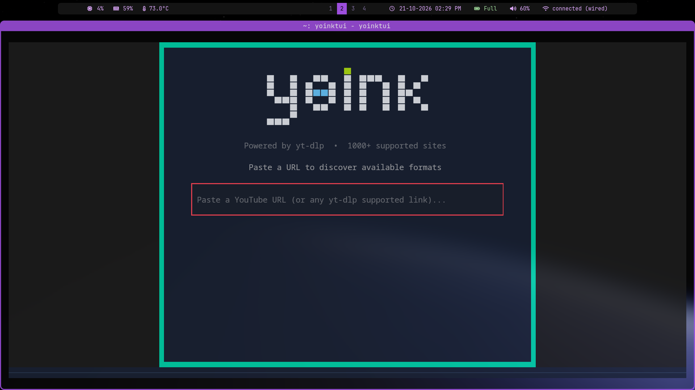
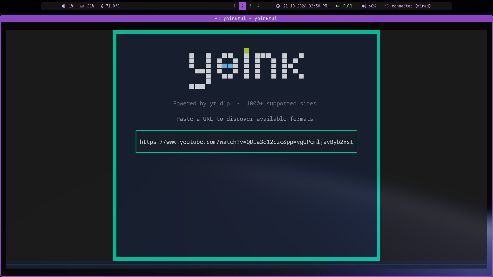
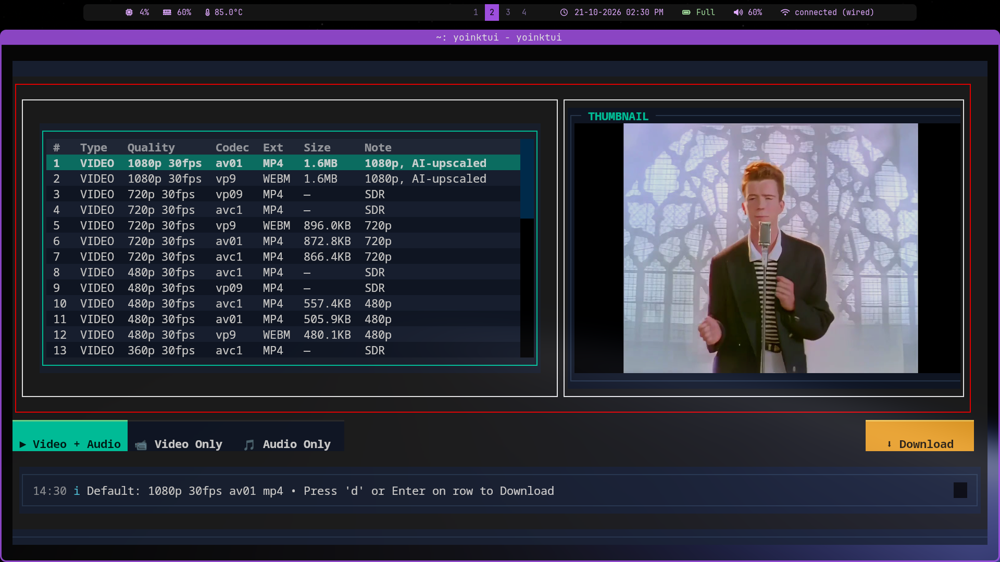
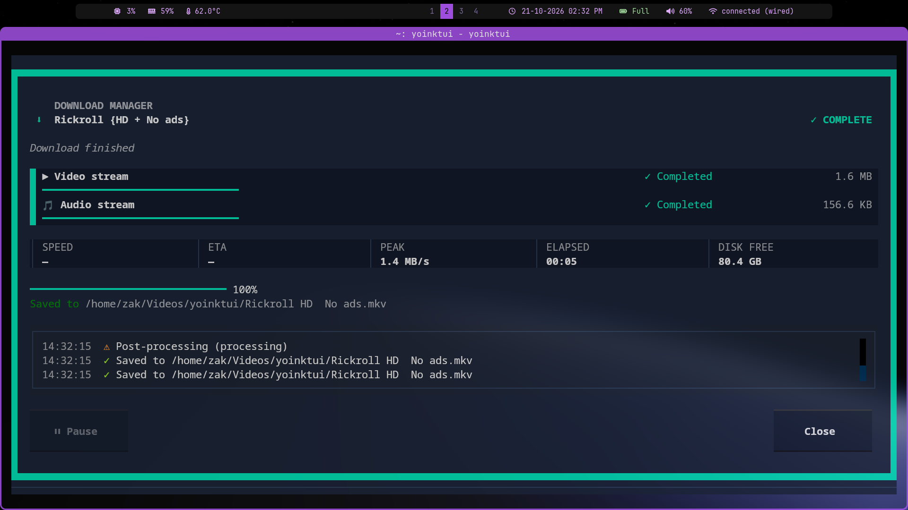

<p align="center">
  <picture>
    <source media="(prefers-color-scheme: dark)" srcset="src/yoinktui/assets/logo-dark.png">
    
  </picture>
</p>

# YoinkTUI

TUI download manager for YouTube (and 1000+ sites) via **yt-dlp** + **ffmpeg**.

> Yoink it. Keep it.

## Features

- **Paste URL → See formats → Download** — clean three-screen flow
- **Steam-style download manager** — per-stream queue, live speed/ETA/peak/disk tiles,
  overall progress, pause/resume, cancel, and a timestamped activity log
- **Live thumbnail** — renders via kitty graphics / sixel / Unicode fallback (`textual-image`)
- **Format picker** — resolution, codec, size, and bitrate at a glance
- **Video + Audio / Video Only / Audio Only** modes
- **Real pause & resume** — suspends the whole yt-dlp process group (POSIX)
- **Dark theme** with teal accent

## Live Demo
<p align="center">
  <a href="https://github.com/user-attachments/assets/4d92a270-7695-44be-a0ad-ab9ccb74ca62">Watch the Demo</a>
</p>

## Screenshots

<p align="center">
  
  <br><br>
  
  <br><br>
  
  <br><br>
  
</p>

## Install

```bash
git clone https://github.com/Zakariya-Zahid/YoinkTUI.git
cd YoinkTUI
uv sync
```

Requires: `yt-dlp`, `ffmpeg`, Python 3.12+

## Run

```bash
uv run yoinktui
```

Or install globally:

```bash
uv tool install -e .
yoinktui
```

## Usage

1. **Paste a URL** — YouTube, Twitter/X, Vimeo, Twitch, TikTok, etc.
2. **Pick a format** — Table shows video & audio streams; arrow keys navigate, Enter selects
3. **Choose mode** — `Video+Audio` (default), `Video Only`, `Audio Only`
4. **Download** — Steam-style dashboard with queue, stats, and activity log

## Configuration

Download directory: `~/Videos/yoinktui/` (override with `--download-dir DIR`).

Quality cap, container, and audio format are currently built-in defaults
(1080p, `mkv`, `mp3`). A `config.toml` with profiles is planned — see
[module 07](docs/plans/07-configuration-profiles.md) and the
[roadmap](ROADMAP.md).

### Cookies and proxy

Some sites need a logged-in browser session or a different network:

```bash
yoinktui --cookies-from-browser firefox
yoinktui --cookies-from-browser "firefox:/path/to/profile" \
  --proxy socks5://127.0.0.1:1080
```

Use the same browser names as yt-dlp: `chrome`, `firefox`, `edge`, `brave`,
or `browser:profile`. Extra yt-dlp flags can be passed with
`--yt-dlp-arg=...` (repeatable).

### TikTok / HTTP 403

TikTok's anti-bot layer sometimes rejects yt-dlp with
`HTTP Error 403: Forbidden` before it can read the video. That is a
TikTok-side block, not a YoinkTUI site limit. Log into TikTok in your
browser and use `--cookies-from-browser`, or try a VPN/proxy. The same URL
may work later without changes.

## Keyboard Shortcuts

| Key | Action |
|-----|--------|
| `Enter` | Submit URL / Select format |
| `↑/↓` | Navigate format table |
| `Esc` | Back / Cancel download |
| `P` / `Space` | Pause / resume download |
| `Ctrl+Q` | Quit app |
| `Ctrl+D` | Toggle dark/light theme |

## Architecture

```
assets/                  # README screenshots + demo video
src/yoinktui/
├── app.py              # Textual App entry point
├── assets/             # App logo (light & dark variants)
├── backend/
│   ├── models.py       # MediaInfo, FormatInfo dataclasses
│   └── ytdlp.py        # yt-dlp orchestration: probe, download, progress, control
└── tui/
    ├── app.tcss        # All styles (Textual 8 compatible)
    ├── widgets.py      # FormatTable, InfoPanel, ThumbnailCard, DownloadDashboard
    └── screens.py      # UrlScreen, FormatScreen, DownloadScreen, ErrorModal
```

- **Backend** runs yt-dlp in a thread (`@work(thread=True)`) so the UI stays responsive
- **Progress** is parsed from yt-dlp's `--progress-template` stdout stream
- **Control** uses POSIX `SIGSTOP`/`SIGCONT` for real pause/resume
- **Thumbnails** are fetched via `httpx` and rendered by `textual-image.AutoImage`

## Roadmap

See [ROADMAP.md](ROADMAP.md) and the per-module plans in [docs/plans/](docs/plans/).

## License

MIT
